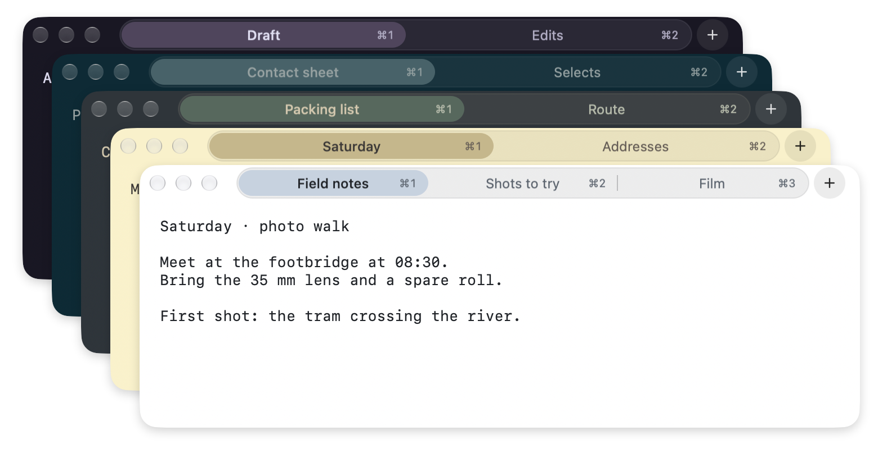

# Jotting

  

A simple macOS scratchpad for quick plain-text notes.

## Features

- **Quick access.** The menu bar icon or a global shortcut (Control + comma by default) brings the scratchpad forward.
- **Autosaved notes.** Jotting keeps each note as you type, even before you give it a name. It can also open and save plain-text and Markdown files.
- **Tabs and windows.** Each note has its own tab. Tabs can be named, reordered, or moved between windows.
- **Custom themes.** Choose a built-in theme or create a JSON theme with your own light and dark color palettes.

## Install

Requires **macOS 14 (Sonoma) or later**.

1. Download `Jotting.dmg` from [GitHub Releases](https://github.com/exelban/jotting/releases).
2. Open the disk image and drag **Jotting** into **Applications**.
3. Launch Jotting. You can open the scratchpad from its menu bar icon or with **Control + comma**. Press the shortcut again while the scratchpad is focused to close that window.

## Configuration

You can find the settings file at `~/Library/Application Support/Jotting/config.json`.

Open it with **Jotting → Settings…** (**⌘,**). Press **⌘S** to apply changes.

- **`application`** controls whether Jotting launches at login, whether its icons appear in the Dock and menu bar, and which global shortcut opens the scratchpad.
- **`interface`** controls the color theme, system/light/dark appearance, classic or glass background, and line markers (none, dots, or numbers).
- **`font`** controls the editor’s font family, size (8–72 pt), weight, and line height (1–3×).

The **?** button in the settings tab lists supported values.

## Custom theme

Copy a [built-in theme](Jotting/Resources/Themes/dracula.json) to `~/Library/Application Support/Jotting/Themes/my-theme.json`. Edit the colors in both the `light` and `dark` palettes using `#RRGGBB` values.

In the `interface` section of your settings, set `"theme": "my-theme"` to match the filename without its extension. Press **⌘S** to apply it.

## License

[MIT License](LICENSE)
